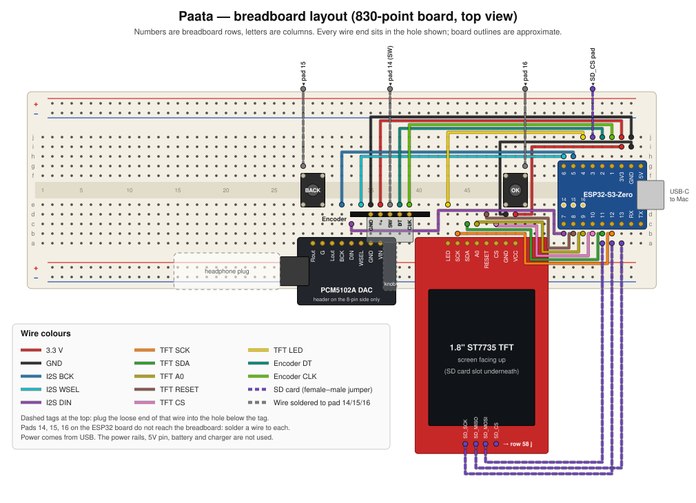

# Breadboard build

A layout for testing Paata on one full-size (830-point) breadboard before moving to perf board. The connections are the same as in [WIRING.md](WIRING.md); this page only says where each part sits and which hole each jumper goes in.

Holes are written as row + column, so `61j` is row 61, column j. Rows that are joined by the breadboard: columns a–e of one row are one strip, columns f–j of the same row are another.

## Before you start

- **ESP32-S3-Zero**: solder pin headers to both long edges (9 pins each). Pads **14, 15 and 16** sit inside the board and will not reach the breadboard, so solder a loose wire about 15 cm long to each.
- **DAC**: solder a header to the 8-pin side only (VIN … Rout). Leave the six config pads on the other side empty.
- **Display**: solder a 4-pin header to the SD pads (SD_CS, SD_MOSI, SD_MISO, SD_SCK). These take female-to-male jumpers.
- **Jumpers**: about 25 male-to-male, and 4 female-to-male for the SD pads.
- Power comes from the USB cable while on the breadboard. Leave the battery, charger and the 5V pin unconnected.

## Where each part goes

| Part | Holes | Orientation |
|---|---|---|
| ESP32-S3-Zero | rows 55–63, pins in columns c and g | USB port hanging off the right end. Row 63 is 5V (column g) and TX (column c). |
| DAC | column f, rows 29–36 | Board body over columns e–b, headphone jack pointing left. Row 29 = Rout, row 36 = VIN. |
| Encoder | column i, rows 39–43 | Standing upright, knob pointing toward you. Row 39 = GND, row 43 = CLK. |
| Display | column a, rows 43–50 | Screen up, board hanging off the near edge of the breadboard. Row 43 = LED, row 50 = VCC. |
| PREV button | across the centre gap, rows 4 and 6 | Legs in columns e and f. |
| NEXT button | across the centre gap, rows 9 and 11 | Legs in columns e and f. |

Keep rows 15–26 around the centre gap empty: the headphone plug lies there.

If the ESP32 board's pin rows do not land in columns c and g on your breadboard, use whichever columns fit; only the row numbers matter.

## Jumpers

### Power

| From | To | Carries |
|---|---|---|
| 61j | top + rail | 3.3 V from the ESP32 |
| 62j | top − rail | GND |
| top − rail (row 2) | bottom − rail (row 2) | GND to the bottom rail |
| 36j | top + rail | DAC VIN |
| 35j | top − rail | DAC GND |
| 40j | top + rail | Encoder + |
| 39j | top − rail | Encoder GND |
| 50e | 61i | Display VCC |
| 49e | 62i | Display GND |
| 6d | bottom − rail | PREV button GND |
| 11d | bottom − rail | NEXT button GND |

### DAC (I2S)

| From | To | Signal |
|---|---|---|
| 32i | 56h | BCK → GPIO 5 |
| 34h | 55h | WSEL → GPIO 6 |
| 33g | 55b | DIN → GPIO 7 |

### Display

| From | To | Signal |
|---|---|---|
| 43e | 57i | LED (backlight) → GPIO 4 |
| 44b | 60b | SCK → GPIO 12 |
| 45c | 59b | SDA → GPIO 11 |
| 46c | 57b | A0 → GPIO 9 |
| 47d | 56b | RESET → GPIO 8 |
| 48c | 58b | CS → GPIO 10 |

### SD card (female-to-male jumpers from the pads)

| From pad | To | Signal |
|---|---|---|
| SD_SCK | 60a | GPIO 12 |
| SD_MOSI | 59a | GPIO 11 |
| SD_MISO | 61a | GPIO 13 |
| SD_CS | 58j | GPIO 3 |

### Encoder and buttons

| From | To | Signal |
|---|---|---|
| 42j | 59j | Encoder DT → GPIO 2 |
| 43j | 60j | Encoder CLK → GPIO 1 |
| wire from pad 14 | 41j | Encoder SW |
| wire from pad 15 | 4h | PREV button |
| wire from pad 16 | 9h | NEXT button |

## Check before plugging in USB

1. With a multimeter on continuity, confirm the top + rail and top − rail are **not** connected to each other.
2. Confirm 3V3 (row 61) reaches DAC VIN (row 36), display VCC (row 50) and encoder + (row 40).
3. On some breadboards the power rails are split in the middle. If yours are, add a short jumper across the break on the top +, top − and bottom − rails.

## If something does not work

- **"SD card not found"**: the SD jumpers are long. Lower the SD speed in `firmware/src/main.cpp` from `20000000` to `4000000` and try again.
- **Picture upside down**: change `tft.setRotation(0)` to `tft.setRotation(2)`.
- **Knob scrolls the wrong way**: swap the jumpers in 59j and 60j.
- **Button does nothing**: turn the button a quarter turn; its legs are joined in pairs.
