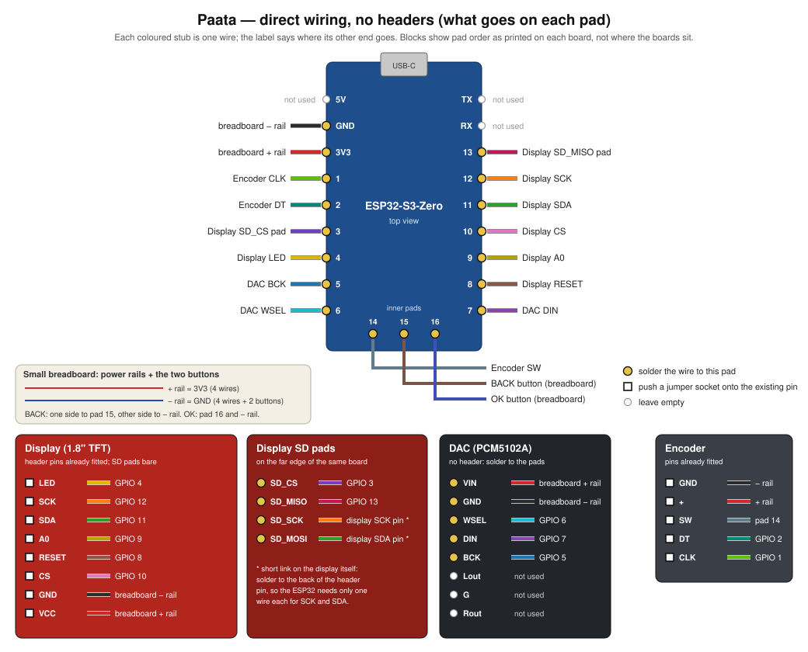

# Direct wiring (no headers)

Paata built with wires soldered straight to the pads, in the positions the boards will take in the case. Nothing has headers except the encoder, which keeps the pins it came with (solder the wires onto them). Only the two buttons sit on a breadboard for now.

The connections are the same as in [WIRING.md](WIRING.md). If you would rather use headers and a full breadboard, see [BREADBOARD.md](BREADBOARD.md).

## How to read the diagram

- You are looking at the **back** of the build: the display lies screen-down on the desk, and the other boards are component side up.
- The boards are drawn in their real orientation but spread apart. The small inset shows how they close up.
- Each tag is one wire. Its colour is the wire colour and its number matches the list below; the same number appears at both ends.
- Power is daisy-chained from board to board, so a few pads take two wires.

## Wire list

Six wire colours are enough: wires that share a colour never sit on neighbouring pads.

### Power

| Wire | Colour | From | To |
|---|---|---|---|
| R1 | red | ESP32 3V3 | DAC VIN |
| R2 | red | DAC VIN | Display VCC |
| R3 | red | Display VCC | Encoder + |
| K1 | black | ESP32 GND | DAC GND |
| K2 | black | DAC GND | Display GND |
| K3 | black | Display GND | Encoder GND |
| K4 | black | ESP32 GND | Breadboard − (both buttons) |

### Signals

| Wire | Colour | From | To | Signal |
|---|---|---|---|---|
| 1 | yellow | ESP32 12 | Display SCK | SPI clock |
| 2 | blue | ESP32 11 | Display SDA | SPI data out |
| 3 | yellow | ESP32 10 | Display CS | Display select |
| 4 | turquoise | ESP32 9 | Display A0 | Data / command |
| 5 | white | ESP32 8 | Display RESET | Reset |
| 6 | white | ESP32 4 | Display LED | Backlight |
| 7 | turquoise | ESP32 3 | Display SD_CS | SD card select |
| 8 | white | ESP32 13 | Display SD_MISO | SD data in |
| 9 | yellow | Display SD_SCK | Display SCK | Link on the display board |
| 10 | blue | Display SD_MOSI | Display SDA | Link on the display board |
| 11 | blue | ESP32 5 | DAC BCK | I2S bit clock |
| 12 | yellow | ESP32 6 | DAC WSEL | I2S word select |
| 13 | turquoise | ESP32 7 | DAC DIN | I2S data |
| 14 | turquoise | ESP32 1 | Encoder CLK | Encoder A |
| 15 | yellow | ESP32 2 | Encoder DT | Encoder B |
| 16 | white | ESP32 14 (inner pad) | Encoder SW | Encoder click |
| 17 | blue | ESP32 15 (inner pad) | BACK button | |
| 18 | yellow | ESP32 16 (inner pad) | OK button | |

That is 25 wires: 3 red, 4 black, 6 yellow, 4 blue, 4 white, 4 turquoise.

Wires 9 and 10 join the SD slot to the display's own clock and data pads, so the ESP32 needs only one wire on each of pads 11 and 12.

On the breadboard, place each button across the centre gap. Wires 17 and 18 go to one leg each; the diagonally opposite leg of both buttons goes to the row where K4 lands.

## Wire lengths

Lay the boards out as in the inset before cutting. Leave about 2 cm of slack on every wire so the boards can be lifted apart for repairs; the encoder and button wires want more, since those parts move to the case walls later.

## Working tips

- Tape each board down while soldering to it, and keep them apart while testing. Loose boards touching is the usual way to short something.
- Solder the ESP32 end of each wire first, then check it with a multimeter before soldering the far end.
- Where a pad takes two wires, twist the two stripped ends together and solder them as one.
- Power from USB only. Leave the battery, charger and 5V pad unconnected for now.

## Check before plugging in USB

With a multimeter on continuity:

1. ESP32 3V3 and GND are **not** connected to each other.
2. 3V3 reaches DAC VIN, display VCC and encoder +; GND reaches the matching pads.
3. No two neighbouring pads are bridged by solder.

## If something does not work

- **"SD card not found"**: lower the SD speed in `firmware/src/main.cpp` from `20000000` to `4000000`. If it still fails, check the three small resistors next to the SD slot (R1–R3); on some of these boards they are too large for a 3.3 V bus and need bridging.
- **Picture upside down**: change `tft.setRotation(0)` to `tft.setRotation(2)`.
- **Knob scrolls the wrong way**: swap wires 14 and 15 at the encoder.
