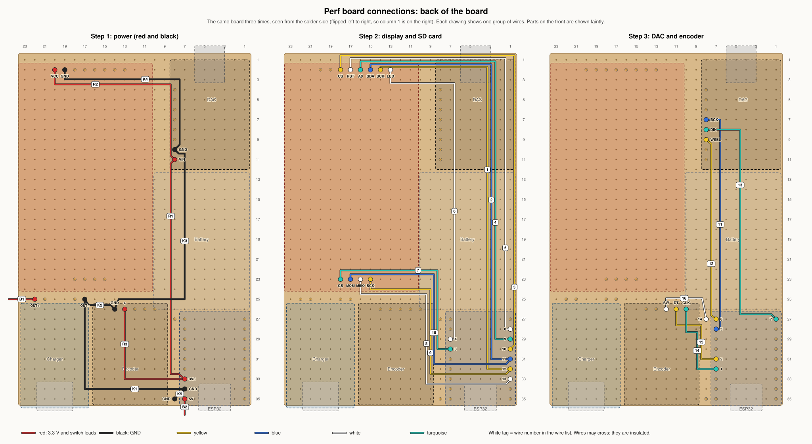

# Perf board build

Everything except the two buttons and the power switch sits on one perf board, 23 columns × 35 rows of holes (about 58 × 89 mm). The buttons go on a small board of their own under the lid, and the switch goes in the case wall. What connects to what is in [WIRING.md](WIRING.md); this page says which hole each part goes in and where each wire is soldered.

Holes are written as column and row: `c7 r33` is column 7, row 33, counted from the top-left corner of the component side. All parts sit on the component side; nothing is mounted on the back.

## Layout

| Part | Holes | Notes |
|---|---|---|
| DAC | 8-pin side in c8, rows 4–11 | Jack at the top edge. Row 4 = Rout, row 11 = VIN. |
| Display | 8-pin header in row 2, c13–c20; SD pads in row 23, c15–c18 | Screen up. c13 = LED, c20 = VCC. The SD card sticks out of the right side. |
| Battery | lies flat in c1–c10, rows 13–26 | Between the DAC and the ESP32, left of the display. Held with tape, no holes used. |
| ESP32-S3-Zero | pins in c1 and c7, rows 27–35 | Bottom-left, USB-C at the bottom edge. Row 27 is GPIO 7 (c1) and GPIO 6 (c7). |
| Encoder (19 × 26 mm) | 5-pin header in row 26, c10–c14 | Bottom-middle, knob up, header at the top end. c10 = CLK, c14 = GND. |
| Charger (TP4056) | bottom-right, c17–c23, rows 26–35 | USB-C at the bottom edge. Its four pads are wired to holes c17, c18, c21, c22 in row 25. |

Ports: headphone jack on the top edge, flashing port and charging port on the bottom edge, SD card on the right side.

The bottom row is a close fit: ESP32, encoder and charger side by side leave about 1 mm between them.

## Before soldering

- Fit pin headers to the ESP32 (2 × 9), the DAC (8-pin side), the display (8-pin and 4-pin) and the encoder (5-pin, straight). Test-fit every part in its holes before soldering anything.
- **Display**: check that the 8-pin header and the SD pads both drop into holes at the same time. If the SD pads are off the grid, leave them without pins and use four short wires.
- **Encoder**: only one end has pins. Put a piece of foam tape under the other end.
- **ESP32 pads 14, 15, 16**: these are flat pads on top of the board. Solder a wire to each. The wire from pad 14 goes down through hole `c8 r27`; the wires from pads 15 and 16 stay on the front and go to the button board.
- **Charger**: it sits on foam tape. Solder a short wire from each of its four pads down through the hole next to it in row 25 (c17, c18, c21, c22); use whichever hole is nearest each pad and follow the labels printed on the charger.
- **Battery**: fit it last, after all wires are soldered and tested. It must not be wedged against header pins or the ESP32's pad wires: put a strip of thin card or tape along the DAC and ESP32 edges and tape the cell down. Nothing sharp should press on it.
- If the DAC's jack does not clear the top edge, move the DAC up one row.

## Button board

A piece of perf board 7 × 4 holes (the small drawing beside the layout). Each 6 × 6 mm button has legs on two opposite sides; turn both buttons so the legs point to the top and bottom of the small board. A button then takes holes two columns apart and three rows apart: BACK in c1 and c3, OK in c5 and c7, rows 1 and 4.

Wire two diagonally opposite legs of each button, which works whichever way the button is turned:

- BACK: top-left leg to ESP32 pad 15 (blue), bottom-right leg to ground.
- OK: top-right leg to ESP32 pad 16 (yellow), bottom-left leg to ground.
- The two ground legs are two holes apart: join them with a short wire and run one black wire to the main board (wire K5).

Solder the other four legs for strength and leave them unwired. Three wires leave the board; make them about 8 cm long so the lid can be opened.

## Connections

All wires run on the back (solder side), pad to pad. The drawing shows the back of the board three times, one group of wires each, in the order to solder them. Seen from the back, left and right are swapped, so column 1 is on the right. The white tag on each wire is its number in the tables below.

The routes are a guide: run the wires as is convenient. Wires may cross.

### Step 1: power

| Wire | Colour | From | To |
|---|---|---|---|
| R1 | red | ESP32 3V3 `c7 r33` | DAC VIN `c8 r11` |
| R2 | red | DAC VIN `c8 r11` | Display VCC `c20 r2` |
| R3 | red | ESP32 3V3 `c7 r33` | Encoder + `c13 r26` |
| K1 | black | Charger OUT− `c17 r25` | ESP32 GND `c7 r34` |
| K2 | black | Charger OUT− `c17 r25` | Encoder GND `c14 r26` |
| K3 | black | Encoder GND `c14 r26` | DAC GND `c8 r10` |
| K4 | black | DAC GND `c8 r10` | Display GND `c19 r2` |
| K5 | black | ESP32 GND `c7 r34` | Button board ground, through hole `c8 r35` to the front |
| B1 | red | Charger OUT+ `c22 r25` | Power switch, middle pin |
| B2 | red | Power switch, either outer pin | ESP32 5V `c7 r35` |
| | red | Battery + | Charger B+ `c21 r25` |
| | black | Battery − | Charger B− `c18 r25` |

B1 and B2 are loose leads to the switch in the case wall; cut them to length once the case exists. The switch's third pin stays empty. The battery leads run on the front, along the gap below the display, to the charger's B+ and B− (holes or the pads themselves).

Keep the power switch off while a USB cable is plugged into the ESP32.

### Step 2: display and SD card

| # | Colour | From | To |
|---|---|---|---|
| 1 | yellow | GPIO 12 `c1 r32` | Display SCK `c14 r2` |
| 2 | blue | GPIO 11 `c1 r31` | Display SDA `c15 r2` |
| 3 | yellow | GPIO 10 `c1 r30` | Display CS `c18 r2` |
| 4 | turquoise | GPIO 9 `c1 r29` | Display A0 `c16 r2` |
| 5 | white | GPIO 8 `c1 r28` | Display RESET `c17 r2` |
| 6 | white | GPIO 4 `c7 r29` | Display LED `c13 r2` |
| 7 | turquoise | GPIO 3 `c7 r30` | SD_CS `c18 r23` |
| 8 | white | GPIO 13 `c1 r33` | SD_MISO `c16 r23` |
| 9 | yellow | GPIO 12 `c1 r32` | SD_SCK `c15 r23` |
| 10 | blue | GPIO 11 `c1 r31` | SD_MOSI `c17 r23` |

### Step 3: DAC and encoder

| # | Colour | From | To |
|---|---|---|---|
| 11 | blue | GPIO 5 `c7 r28` | DAC BCK `c8 r7` |
| 12 | yellow | GPIO 6 `c7 r27` | DAC WSEL `c8 r9` |
| 13 | turquoise | GPIO 7 `c1 r27` | DAC DIN `c8 r8` |
| 14 | turquoise | GPIO 1 `c7 r32` | Encoder CLK `c10 r26` |
| 15 | yellow | GPIO 2 `c7 r31` | Encoder DT `c11 r26` |
| 16 | white | Pad 14, through hole `c8 r27` | Encoder SW `c12 r26` |
| 17 | blue | Pad 15 | BACK button (on the front, to the button board) |
| 18 | yellow | Pad 16 | OK button (on the front, to the button board) |

## Check before powering up

With a multimeter on continuity:

1. 3V3 (`c7 r33`) and GND (`c7 r34`) are **not** connected to each other.
2. 3V3 reaches DAC VIN, display VCC and encoder +.
3. GND reaches DAC GND, display GND, encoder GND and one leg of each button.
4. Each button connects its signal wire to GND only while pressed.

Then plug USB into the ESP32 with the power switch off, and flash.
