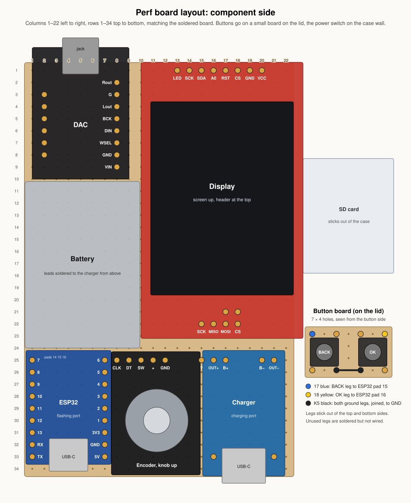

# Perf board build

Everything on one perf board, 22 columns × 35 rows of holes (about 56 × 89 mm). What connects to what is in [WIRING.md](WIRING.md); this page says which hole each part goes in and where each wire is soldered.

Holes are written as column and row: `c8 r33` is column 8, row 33, counted from the top-left corner of the component side. The DAC, ESP32, display, buttons and encoder sit on the component side. The battery and charger sit on the solder side, behind the display.

## Layout

| Part | Holes | Notes |
|---|---|---|
| DAC | 8-pin side in c8, rows 4–11 | Jack at the top edge. Row 4 = Rout, row 11 = VIN. |
| Display | 8-pin header in row 2, c12–c19; SD pads in row 23, c14–c17 | Screen up. c12 = LED, c19 = VCC. The SD card sticks out of the right side. |
| BACK button | c2–c4, rows 17–20 | |
| OK button | c6–c8, rows 17–20 | |
| ESP32-S3-Zero | pins in c2 and c8, rows 27–35 | USB-C at the bottom edge. Row 27 is GPIO 7 (c2) and GPIO 6 (c8). |
| Power switch | c12–c14, row 33 | |
| Encoder (19 × 26 mm) | 5-pin header in row 26, c16–c20 | Knob up, header at the top end. c16 = CLK, c20 = GND. |
| Battery | solder side, behind c9–c22, rows 4–13 | |
| Charger (TP4056) | solder side, behind c12–c22, rows 14–21 | USB-C at the right edge. Pads towards the middle of the board. |

Ports: headphone jack on the top edge, flashing port on the bottom edge, charging port and SD card on the right side.

## Before soldering

- Fit pin headers to the ESP32 (2 × 9), the DAC (8-pin side), the display (8-pin and 4-pin) and the encoder (5-pin, straight). Test-fit every part in its holes before soldering anything.
- **Display**: check that the 8-pin header and the SD pads both drop into holes at the same time. If the SD pads are off the grid, leave them without pins and use four short wires.
- **Encoder**: only one end has pins. Put a piece of foam tape under the other end.
- **ESP32 pads 14, 15, 16**: these are flat pads on top of the board. Solder a wire to each and pass it down through a hole: pad 14 through `c11 r27`, pad 15 through `c2 r25`, pad 16 through `c5 r25`.
- **Battery and charger**: fit them last, after all wires are soldered and tested. Trim the solder joints flat, keep wires out from under the battery where possible, and put a piece of thin card between the board and the battery before taping it down. Nothing sharp should press on the cell.
- If the DAC's jack does not clear the top edge, move the DAC up one row.

## Connections

All wires run on the back (solder side), pad to pad. The drawing shows the back of the board three times, one group of wires each, in the order to solder them. Seen from the back, left and right are swapped, so column 1 is on the right. The white tag on each wire is its number in the tables below.

The routes are a guide: keep wires out of the area the battery and charger will cover, and otherwise run them as is convenient. Wires may cross.

### Step 1: power

| Wire | Colour | From | To |
|---|---|---|---|
| R1 | red | ESP32 3V3 `c8 r33` | DAC VIN `c8 r11` |
| R2 | red | DAC VIN `c8 r11` | Display VCC `c19 r2` |
| R3 | red | ESP32 3V3 `c8 r33` | Encoder + `c19 r26` |
| K1 | black | Charger OUT− | ESP32 GND `c8 r34` |
| K2 | black | Charger OUT− | OK button `c8 r20` |
| K3 | black | OK button `c8 r20` | DAC GND `c8 r10` |
| K4 | black | DAC GND `c8 r10` | Display GND `c18 r2` |
| K5 | black | OK button `c8 r20` | BACK button `c4 r20` |
| K6 | black | ESP32 GND `c8 r34` | Encoder GND `c20 r26` |
| B1 | red | Charger OUT+ | Switch `c14 r33` |
| B2 | red | Switch `c13 r33` | ESP32 5V `c8 r35` |

The OK button's ground leg takes three wires. Bridge it to the empty hole `c8 r21` with solder to get a second landing point.

The battery's red wire goes to charger **B+** and its black wire to **B−**. Follow the labels printed on the charger; the pad order on your board may differ from the drawing.

Keep the power switch off while a USB cable is plugged into the ESP32.

### Step 2: display and SD card

| # | Colour | From | To |
|---|---|---|---|
| 1 | yellow | GPIO 12 `c2 r32` | Display SCK `c13 r2` |
| 2 | blue | GPIO 11 `c2 r31` | Display SDA `c14 r2` |
| 3 | yellow | GPIO 10 `c2 r30` | Display CS `c17 r2` |
| 4 | turquoise | GPIO 9 `c2 r29` | Display A0 `c15 r2` |
| 5 | white | GPIO 8 `c2 r28` | Display RESET `c16 r2` |
| 6 | white | GPIO 4 `c8 r29` | Display LED `c12 r2` |
| 7 | turquoise | GPIO 3 `c8 r30` | SD_CS `c17 r23` |
| 8 | white | GPIO 13 `c2 r33` | SD_MISO `c15 r23` |
| 9 | yellow | GPIO 12 `c2 r32` | SD_SCK `c14 r23` |
| 10 | blue | GPIO 11 `c2 r31` | SD_MOSI `c16 r23` |

### Step 3: DAC, encoder, buttons

| # | Colour | From | To |
|---|---|---|---|
| 11 | blue | GPIO 5 `c8 r28` | DAC BCK `c8 r7` |
| 12 | yellow | GPIO 6 `c8 r27` | DAC WSEL `c8 r9` |
| 13 | turquoise | GPIO 7 `c2 r27` | DAC DIN `c8 r8` |
| 14 | turquoise | GPIO 1 `c8 r32` | Encoder CLK `c16 r26` |
| 15 | yellow | GPIO 2 `c8 r31` | Encoder DT `c17 r26` |
| 16 | white | Pad 14 `c11 r27` | Encoder SW `c18 r26` |
| 17 | blue | Pad 15 `c2 r25` | BACK button `c2 r17` |
| 18 | yellow | Pad 16 `c5 r25` | OK button `c6 r17` |

Each button uses two diagonally opposite legs, so its orientation does not matter.

## Check before powering up

With a multimeter on continuity:

1. 3V3 (`c8 r33`) and GND (`c8 r34`) are **not** connected to each other.
2. 3V3 reaches DAC VIN, display VCC and encoder +.
3. GND reaches DAC GND, display GND, encoder GND and one leg of each button.

Then plug USB into the ESP32 with the power switch off, and flash.
