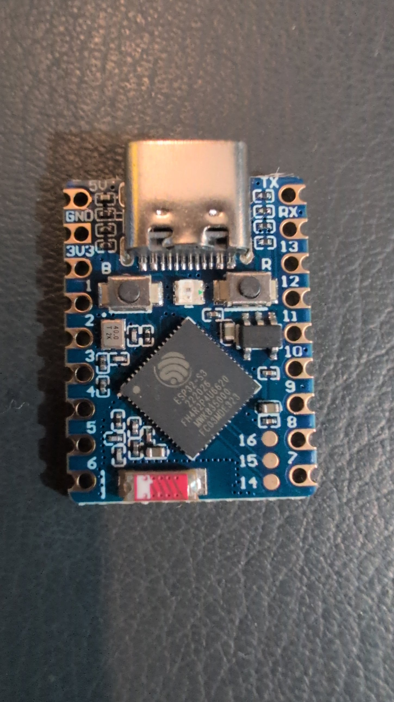
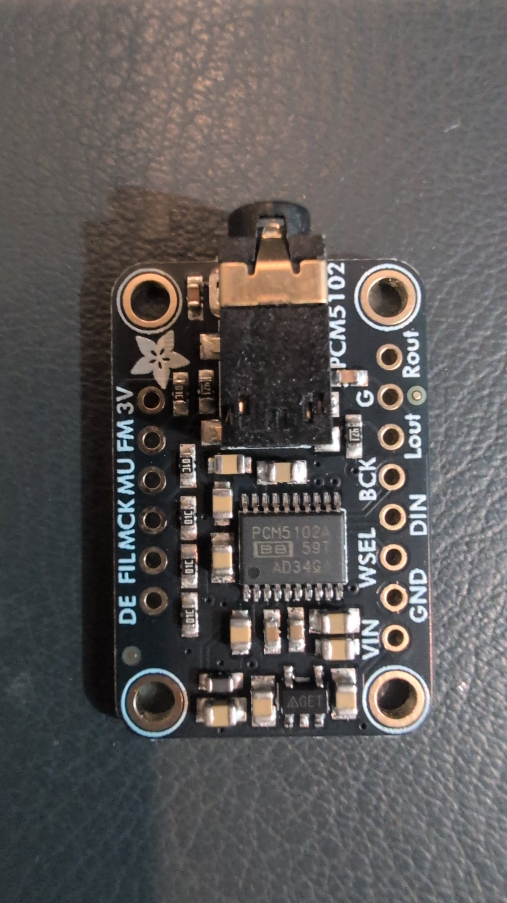
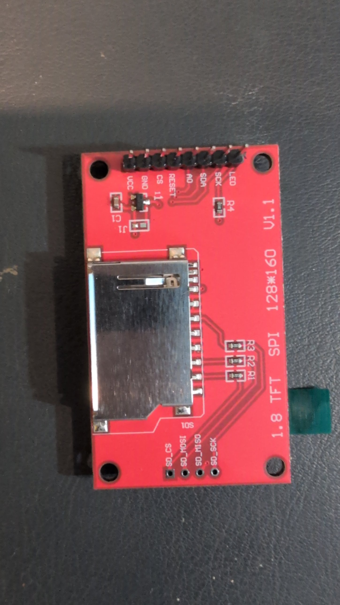
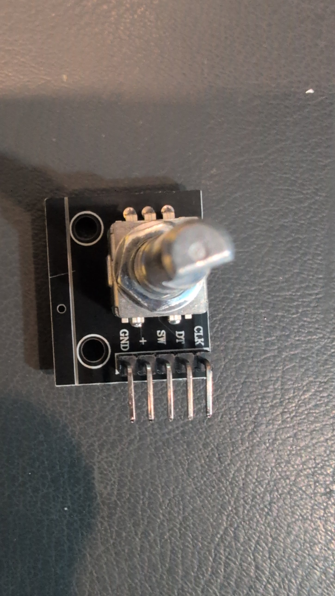
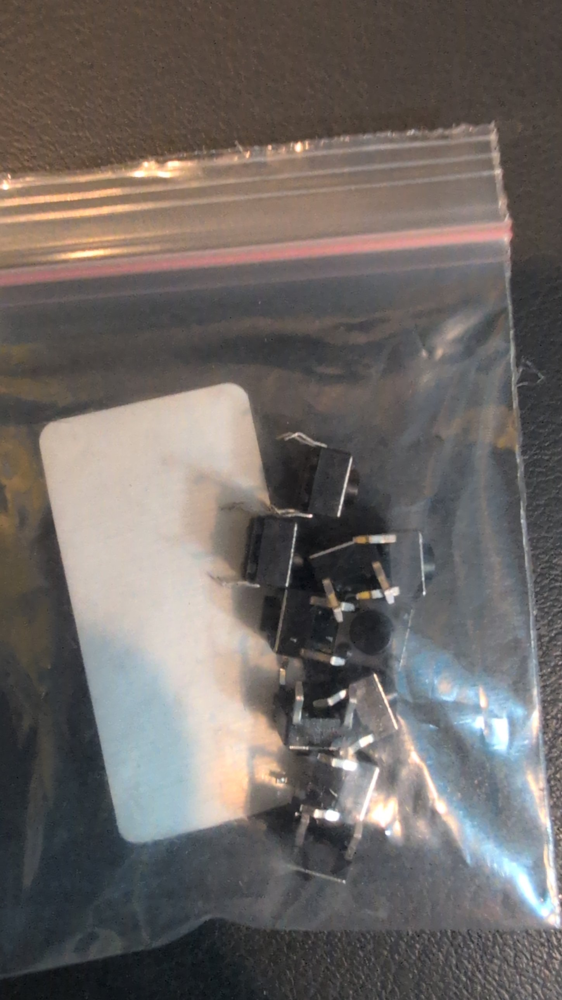
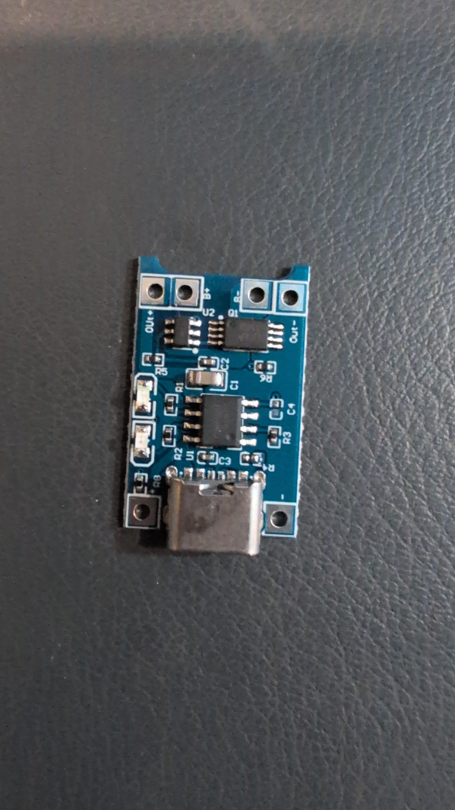
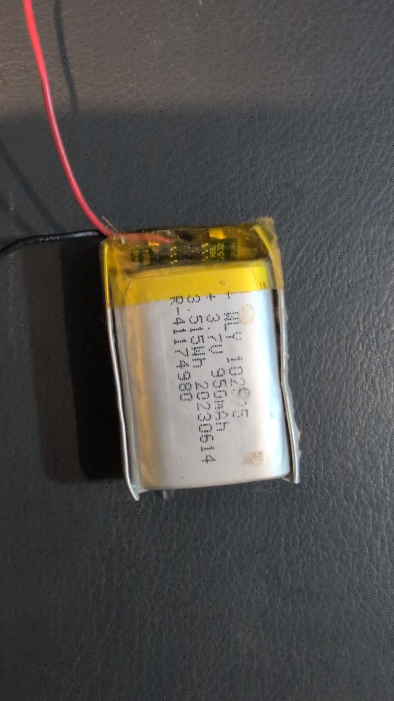

# ESP32-S3 Zero FLAC player — wiring (v1)

All logic is 3.3 V. GPIO numbers = the numbers printed on the S3-Zero.

Building on a breadboard first? See [BREADBOARD.md](BREADBOARD.md) for part placement and a hole-by-hole jumper list.

## 1. Adafruit PCM5102A DAC  (I2S)

| DAC pin | S3-Zero |
|---|---|
| VIN  | 3V3 |
| GND  | GND |
| BCK  | 5 |
| WSEL | 6 |
| DIN  | 7 |
Leave DE / FIL / MCK / MU / FM / 3V open (defaults are correct). Lout/G/Rout unused; use the 3.5 mm jack.

## 2. 1.8" TFT (ST7735, 128x160) — display header

The photo shows the back of the board: the display header along one edge, the SD pads along the opposite edge.

| TFT pin | S3-Zero |
|---|---|
| VCC   | 3V3 |
| GND   | GND |
| CS    | 10 |
| RESET | 8 |
| A0    | 9 |
| SDA   | 11  (MOSI) |
| SCK   | 12 |
| LED   | 4   (backlight, PWM-dimmable) |

## 3. SD slot on the back of the TFT (solder 4 wires/pins)
| SD pad  | S3-Zero |
|---|---|
| SD_CS   | 3 |
| SD_MOSI | 11  (same as TFT SDA) |
| SD_MISO | 13 |
| SD_SCK  | 12  (same as TFT SCK) |

## 4. M274 rotary encoder

| Encoder | S3-Zero |
|---|---|
| GND | GND |
| +   | 3V3 |
| SW  | 14 |
| DT  | 2 |
| CLK | 1 |

## 5. Push buttons (one leg to GPIO, other leg to GND)

| Button | S3-Zero |
|---|---|
| BACK | 15 |
| OK | 16 |

## 6. Power

 

Battery (red +, black −) → TP4056 **B+ / B−**
TP4056 **OUT+** → slide switch → S3-Zero **5V**
TP4056 **OUT−** → S3-Zero **GND**
Charge via the TP4056's USB-C. Flash firmware via the S3-Zero's USB-C.
(For bench testing, skip the battery: just plug the S3-Zero into USB.)

## Controls
Browser:  turn = scroll · OK = open folder / play file · BACK = go up
Playing:  turn = volume · OK = pause/play · BACK = back to browser
Anywhere: hold OK = next track · hold BACK = previous track · knob click = OK
