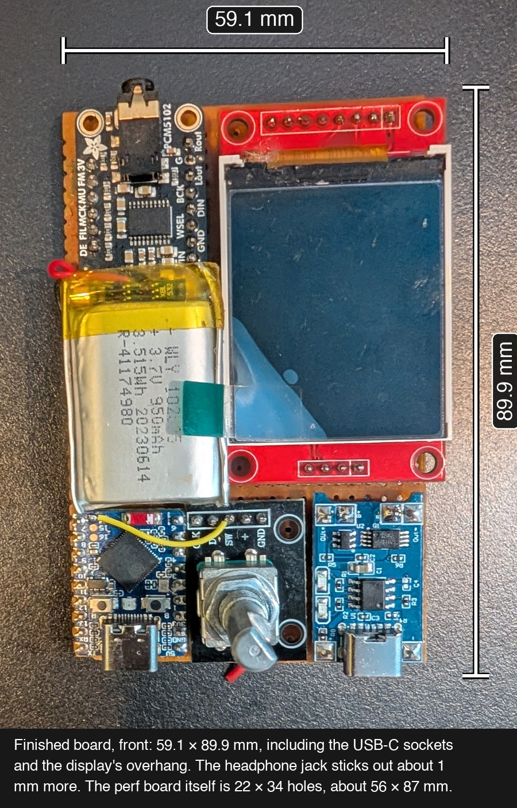
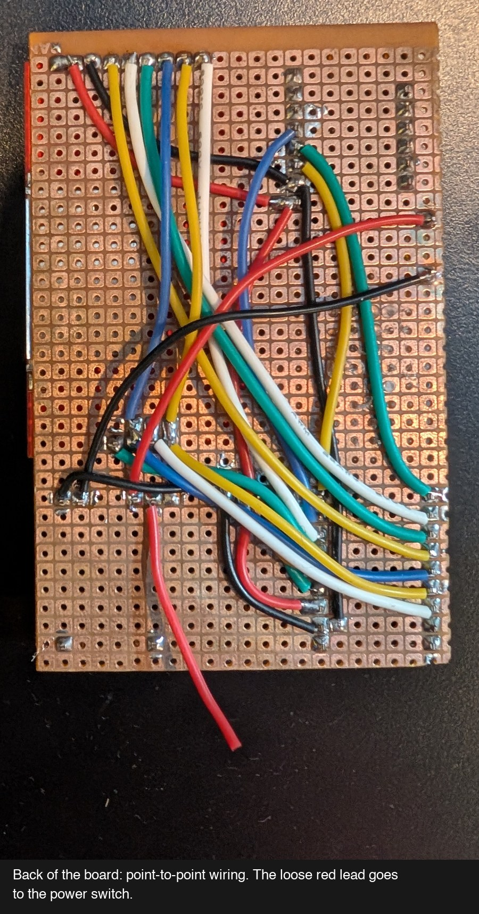

# Assembled board

The finished build on one perf board, with the measurements a case has to fit. All figures are caliper readings in millimetres.

 

| Measurement | mm | Photo |
|---|---|---|
| Length including the USB-C sockets; the headphone jack sticks out about 1 more | 89.9 | [length](length-89.9.jpg) |
| Overall width, perf board plus the display's overhang | 59.1 | [width](width-59.1.jpg) |
| Back wires to the top of the encoder body, without the threaded bush and shaft | 15.4 | [encoder body](encoder-body-15.4.jpg) |
| Greatest thickness, back wires to the top of the battery | 15.7 | [thickness](thickness-15.7.jpg) |
| Back of the perf board to the face of the screen | 8.4 | [screen face](screen-face-8.4.jpg) |
| Back of the perf board to the top of the display board | 5.7 | [display board](display-board-5.7.jpg) |
| Lower edge of the screen to the USB-C end | 36.2 | [screen to end](screen-to-usb-end-36.2.jpg) |

The perf board itself is 22 × 34 holes, about 56 × 87 mm. The encoder's threaded bush and shaft stand above everything else and are not included in these figures. Sizes of the individual parts, including the power switch, are in [../components](../components/).
