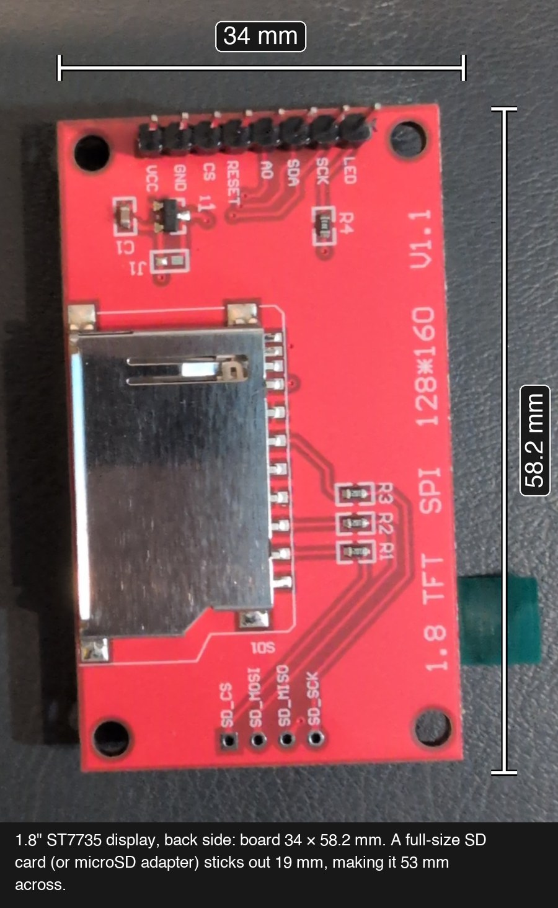
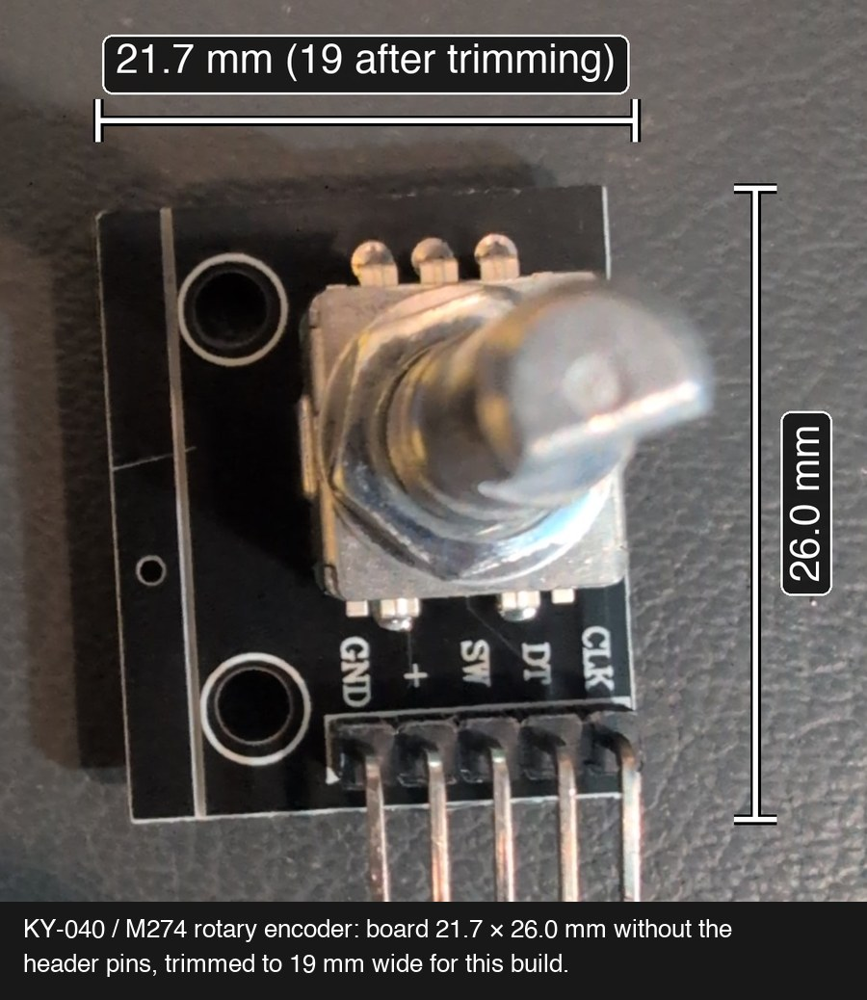
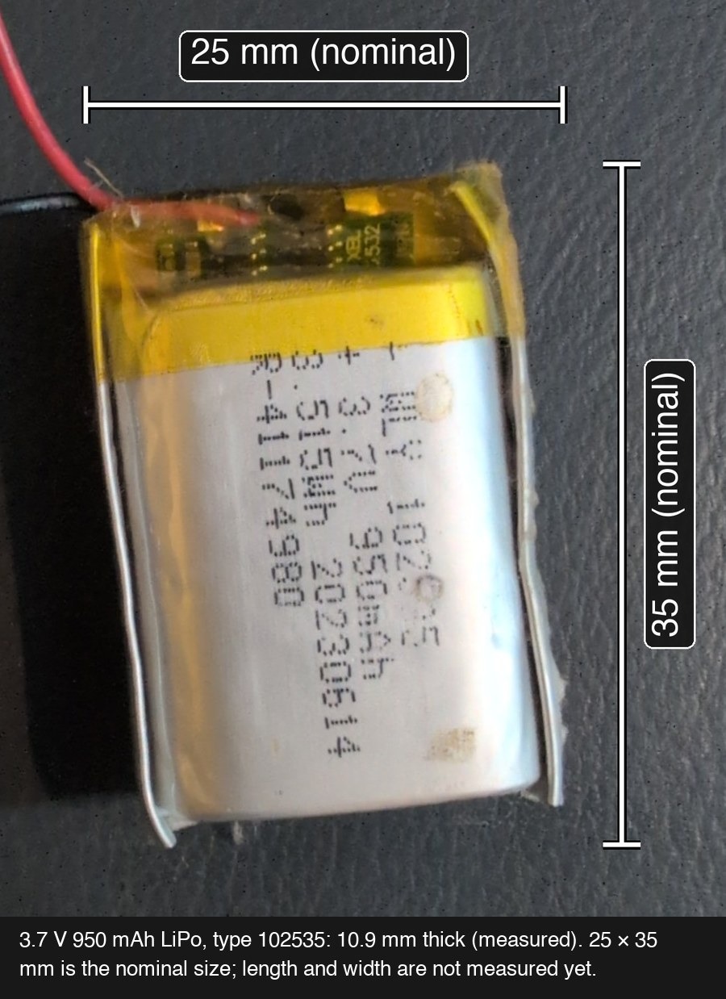
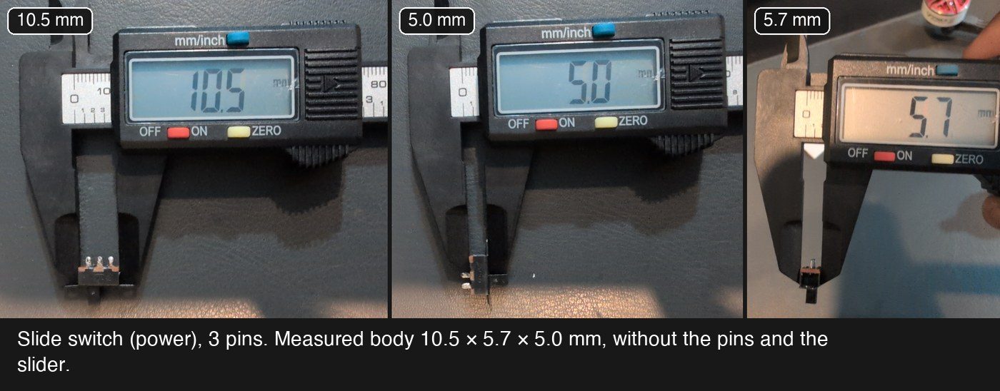

# Components

Each photo carries the part's published size, with our own caliper reading in the caption. How the parts connect is in [../wiring](../wiring/WIRING.md); the finished board and its overall size are in [../assembly](../assembly/).

| | | |
|---|---|---|
|  |  |  |
|  |  |  |

The slide switch photo shows our own measurement only. The encoder has no consistent published size, so its photo shows the measured board.
