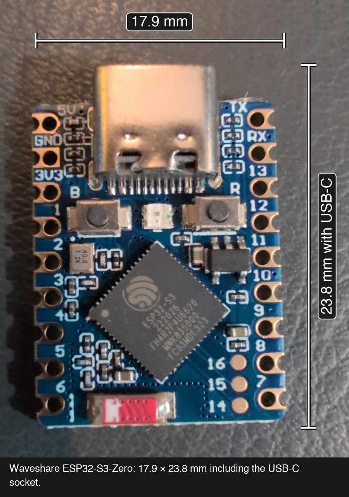
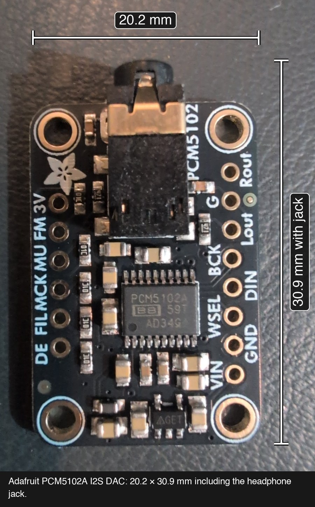
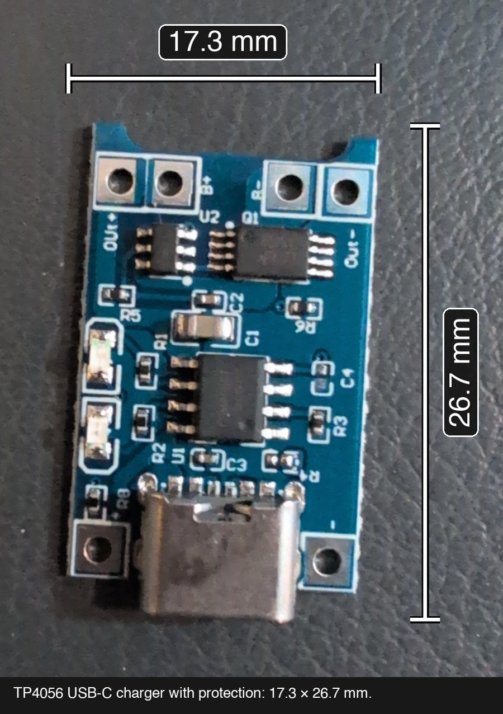

# Components

Each photo carries the part's measured size. How the parts connect is in [../wiring](../wiring/WIRING.md).

| | | |
|---|---|---|
|  |  |  |
|  |  |  |

The slide switch has no photo yet. The battery's length and width are the nominal figures for a 102535 cell; only its thickness has been measured.
